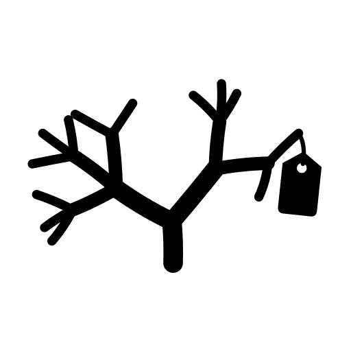

# jellyfin-plugin-tag-browser
Plugin allowing browsing a Jellyfin library using tags/metadata.

## Status

Early development. No release yet. Videos only.

## How it works

Adds a **Tag Browser** channel. Each tag becomes a folder.
Tags containing the separator (default `:`) are split into nested folders:

| Tag | Path in the channel |
|---|---|
| `to practise` | `to practise` |
| `move: cambre` | `move` → `cambre` |
| `a: b: c` | `a` → `b` → `c` |

A video with several tags appears in each matching folder.

Other branches can be enabled alongside Tags:

| Branch | Built from | Example path |
|---|---|---|
| Date | `<premiered>`, else the date recorded in the file, else a date in the file name | `Date` → `2022` → `2022-03 March` → `2022-03-20` |
| Folders | Library folder structure | `Folders` → `Zouk` |
| Genres | `<genre>` | `Genres` → `Brazilian Zouk` |
| Studios | `<studio>` | `Studios` → `…` |
| People | `<actor>` names | `People` → `…` |

Tags only lists tagged videos; the other branches list all videos of the included libraries.

## Requirements

- Jellyfin **12.4.0**.
- Plugins are tied to the server version. Pin your Jellyfin version; update the plugin when upgrading Jellyfin.
- Tested with `lscr.io/linuxserver/jellyfin:12.4ubu2604-ls60`.

## Install

No release yet. Planned: add the plugin repository under **Dashboard → Plugins → Repositories**, then install **Tag Browser** from the catalog.

After installing, run **Dashboard → Scheduled Tasks → Refresh Channels** once, or save the plugin settings.

## Configuration

**Dashboard → Plugins → Tag Browser.** Saving runs Refresh Channels automatically.

| Setting | Default | Notes |
|---|---|---|
| Channel name | `Tag Browser` | Renaming creates a new channel; watched state of its items resets. |
| Tag separator | `:` | Matched exactly. Empty = no nesting. |
| Libraries | All | Only videos from ticked libraries appear. |
| Branches | Tags, Date | Tick to enable; each has a name. Only Tags enabled = tags at the top level. |
| Date branch depth | Year › Month › Day | Or: year, year › month. |
| Date from file name | On | Used when the video has no date (`20220213_180246`, `VID-20250924-WA0005`). |
| Prefer file-name date | Off | Use the file-name date instead of the recorded time (which is UTC). |
| Undated folder | `Undated` | Videos without any date. Empty = hidden. |
| Folder image | Video thumbnail | Thumbnail of a video in the folder (logo if none). Or: logo, none. |
| Folder thumbnail taken from | First video by title | Or: newest, oldest, most recently added. |
| Tile / wide tile / background image | Built-in | Optional server path to a PNG/JPEG. |

## Known issues

- **Alphabetical only.** Jellyfin sorts channel folders and videos by name; the plugin cannot set the order.
- **No library view options.** Jellyfin shows channels without the library's grid/list switch and filters.
- **Separate watched state.** Channel items are distinct from library items; playing from the channel does not mark the library item watched. Each folder placement also has its own watched state.
- **`<premiered>` must be a date only** (`YYYY-MM-DD`). With a time, Jellyfin ignores the field.
- **Recorded times are UTC**, shown in the server's time zone; videos recorded far away can land on the neighbouring day. Use *Prefer file-name date* or set `<premiered>`.
- **Custom image paths** are read on the server. A missing file falls back to the built-in artwork.

## License

Copyright (C) 2026 milkmansson. GPL-3.0-or-later; see [LICENSE](LICENSE).

SPDX-License-Identifier: GPL-3.0-or-later
