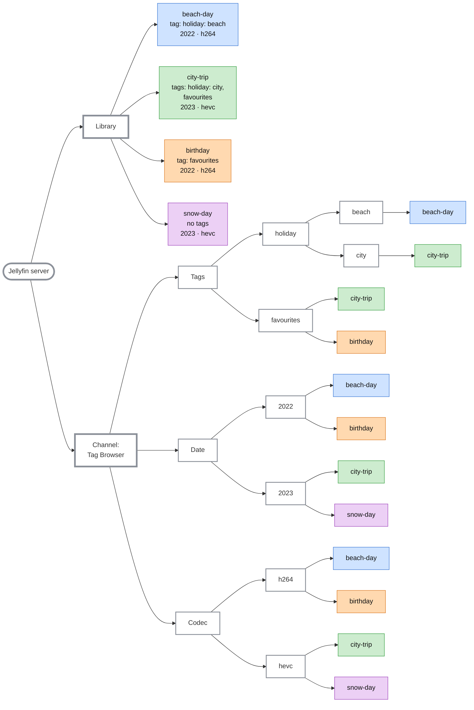

<p align="center">
  <picture>
    <source media="(prefers-color-scheme: dark)" srcset="images/logo-white.png">
    
  </picture>
</p>

# jellyfin-plugin-tag-browser
Plugin allowing browsing a [Jellyfin](https://jellyfin.org/) library using tags/metadata.

> [!WARNING]
> **Status:** Testing and iterative improvements. Please try this out and open a [GitHub issue](https://github.com/milkmansson/jellyfin-plugin-tag-browser/issues) with any bugs, comments or features.

## What it does

Adds a **Tag Browser** *channel* to Jellyfin. Each tag becomes a folder, with all similar videos available under that folder.  Videos with multiple tags will appear under all viable tags.  Tags containing the separator (default `:`) are split into nested folders, as shown:



## Branches

In its 'Tag Browser' channel, folders exist with tag names.  A video with several tags appears in every matching folder: `city-trip` in the diagram has the tags `holiday: city` and `favourites`, so it is listed under both `holiday` → `city` and `favourites`.  Other branches can be enabled alongside Tags:

| Branch       | Built from                                                                                          | Example path                                     |
| ------------ | --------------------------------------------------------------------------------------------------- | ------------------------------------------------ |
| Date         | `<premiered>`, else the date recorded in the file, else a date in the file name                     | `Date` → `2022` → `2022-03 March` → `2022-03-20` |
| Folders      | Library folder structure                                                                            | `Folders` → `Holidays`                            |
| `<tag>`      | The tags, either as single label names, or attribute-value-pairs, separated by `:`.                 | *(Example table below)*                          |
| `<property>` | Using video metadata and properties collected by Jellyfin, from metadata and video characteristics. | `video.codec` → `h264` <br>                      |

Tags only lists tagged videos; the other branches list all videos of the included libraries.

| Tag              | Path in the channel          |
| ---------------- | ---------------------------- |
| `favourites`     | `Tags` → `favourites`        |
| `holiday: beach` | `Tags` → `holiday` → `beach` |
| `holiday: city`  | `Tags` → `holiday` → `city`  |

> [!TIP] 
> Any metadata property can become its own top-level folder, listing every distinct value beneath it (studios, actors, year, codec, …). To do this, In the plugin settings (**Dashboard** -> **Plugins** -> **Tag Browser** -> **Settings** ), add a row to the **Property Branches** table:
> - **Property** (required): what to group by. Names are Jellyfin's own, not case-sensitive. The settings page suggests names while typing but accepts anything.
> - **Shown as** (optional): the folder name in the channel. Useful to rename something like `video.codec` to `codec`.  (Default: the property stays as it was named.)
> 
> The table is empty by default, and uses tags alone, processing any/all tags in the selected library (or all libraries, if none ore specified).

### Which properties can I use?

Jellyfin keeps three kinds of information about a video. Each can become a branch, but they are set up in different places. All names come straight from Jellyfin and its database. The plugin does not keep its own list, and no list needs to be configured.

| Kind | What it is | How to use it | Examples |
|---|---|---|---|
| **1. Tags** | Labels added by hand | Own branch (see above), not a Property row. Use a tag when nothing Jellyfin already knows about the video describes the grouping needed. | `favourites`, `holiday: beach` |
| **2. Metadata** | Descriptive information about the video, from the NFO file or an online provider | Property row, using Jellyfin's property name. | `genres`, `studios`, `productionYear`, `officialRating`, `productionLocations`, `originalTitle`, `communityRating`, `dateCreated`<br>People: `person.actor`, `person.director`, `person.writer` |
| **3. File properties** | What is inside the video file itself, rather than what it is about | Property row: `video.`, `audio.` or `subtitle.` followed by a property name. | `video.codec`, `video.height`, `video.bitDepth`, `audio.language`, `audio.channels`, `audio.channelLayout`, `subtitle.language` |
| **4. Not usable** | `tag` (tags have their own branch), and anything that is not text, a number, yes/no, a date or an option | Nothing is shown. A name that matches nothing shows nothing, which makes typos easy to spot. | images, nested objects |

Where the names come from:

- **Metadata** names are the public properties of Jellyfin's [`BaseItem`](https://github.com/jellyfin/jellyfin/blob/master/MediaBrowser.Controller/Entities/BaseItem.cs) and [`Video`](https://github.com/jellyfin/jellyfin/blob/master/MediaBrowser.Controller/Entities/Video.cs) classes (and `Episode` for episodes). Type the property name as it is written there. Use the version of the source that matches the Jellyfin server in use; the properties can change between versions.
- **People** are one example of metadata. Jellyfin stores them separately from the video, so they are written `person.<role>` rather than as a plain name. The roles are Jellyfin's person kinds: `actor`, `director`, `writer`, `producer`, `guestStar`, `composer`.
- **File properties** are the properties of Jellyfin's [`MediaStream`](https://github.com/jellyfin/jellyfin/blob/master/MediaBrowser.Model/Entities/MediaStream.cs). A video with several audio tracks appears under each value. Container and size (`container`, `width`, `height`) are on the video itself, so they count as metadata.

#### What the NFO fills in

The plugin groups by what Jellyfin imported, not by the NFO file itself, so an NFO element only helps if Jellyfin reads it. From Jellyfin's [NFO parser](https://github.com/jellyfin/jellyfin/blob/master/MediaBrowser.XbmcMetadata/Parsers/BaseNfoParser.cs):

| **Jellyfin NFO element** | **Jellyfin internal property** (use this in Tag Browser) |
|---|---|
| `<genre>` | `genres` |
| `<studio>` | `studios` |
| `<year>` | `productionYear` |
| `<mpaa>` | `officialRating` |
| `<country>` (several separated by `/` inside one element; a second `<country>` element replaces the first) | `productionLocations` |
| `<countrycode>` | `preferredMetadataCountryCode` |
| `<language>` | `preferredMetadataLanguage` |
| `<originaltitle>` | `originalTitle` |
| `<title>` / `<name>` | `name` |
| `<premiered>`, `<aired>`, `<releasedate>` | `premiereDate` (the Date branch is usually better) |
| `<rating>` | `communityRating` |
| `<criticrating>` | `criticRating` |
| `<customrating>` | `customRating` |
| `<tagline>` | `tagline` |
| `<actor>`, `<director>`, `<writer>`, `<credits>` | `person.actor`, `person.director`, `person.writer`, `person.writer` (`<credits>` is split on `/`) |
| `<tag>` | not a property; the Tags branch |

Elements not in this table (for example a made-up `<mood>`) are ignored by Jellyfin, so they cannot be grouped by. Properties that are different for every video (`name`, `path`, `video.bitRate`) give one folder per value, which is rarely useful.

#### A complete NFO example

The NFO for `city-trip` from the diagram, saved next to the video as `city-trip.nfo`. The diagram shows only two of its tags, to keep it small. This file uses seven, to show what tags can do.

```xml
<?xml version="1.0" encoding="UTF-8" standalone="yes"?>
<movie>
  <title>City trip</title>
  <originaltitle>City trip (Lisbon)</originaltitle>
  <tagline>Three days, too many tiles</tagline>
  <plot>A long weekend in Lisbon with the family: trams, custard tarts and a very steep hill.</plot>

  <!-- Normal movie metadata fields: used here to surface details in the player. -->
  <year>2023</year>
  <premiered>2023-06-14</premiered>
  <mpaa>G</mpaa>
  <rating>8.5</rating>

  <genre>Travel</genre>
  <genre>Family</genre>
  <studio>Home movies</studio>
  <country>Portugal</country>

  <director>Alex</director>
  <credits>Alex</credits>
  <actor>
    <name>Bob</name>
    <role>Camera</role>
  </actor>

  <!-- Plain tag: one folder. -->
  <tag>favourites</tag>
  <tag>to edit</tag>
  
  <!-- ":" splits a tag into nested folders. -->
  <tag>holiday: city</tag>
  <tag>season: summer</tag>
  
  <!-- Attribute-value pairs: several tags can share a first level. -->
  <tag>with: grandma</tag>
  <tag>with: cousins</tag>

  <!-- Any depth is allowed -->
  <tag>holiday: europe: portugal: lisbon</tag>
</movie>
```

**Tags.** The seven `<tag>` elements place the one video in seven folders of the **Tags** branch. Nothing needs configuring for this.

| Tag | Path in the channel |
|---|---|
| `favourites` | `Tags` → `favourites` |
| `to edit` | `Tags` → `to edit` |
| `holiday: city` | `Tags` → `holiday` → `city` |
| `season: summer` | `Tags` → `season` → `summer` |
| `with: grandma` | `Tags` → `with` → `grandma` |
| `with: cousins` | `Tags` → `with` → `cousins` |
| `holiday: europe: portugal: lisbon` | `Tags` → `holiday` → `europe` → `portugal` → `lisbon` |

What this shows about tags:

- A tag can be a plain label (`favourites`) or a label with a value (`with: grandma`).
- Tags that share a first part share a folder: `with: grandma` and `with: cousins` both sit under `with`, and `holiday: city` and `holiday: europe: portugal: lisbon` both sit under `holiday`.
- Depth is not limited. The separator can be used any number of times.
- A tag works as a checklist too. `to edit` is a folder of videos still needing attention, and removing the tag from the NFO removes the video from it.

**Everything else** in the file can feed a branch too, but only where one is switched on or a Property row is added:

| NFO element | Branch | Path in the channel |
|---|---|---|
| `<premiered>` | Date (enabled in the settings) | `Date` → `2023` → `2023-06 June` → `2023-06-14` |
| `<genre>` | Property row `genres` | `genres` → `Travel` and `genres` → `Family` |
| `<studio>` | Property row `studios` | `studios` → `Home movies` |
| `<country>` | Property row `productionLocations` | `productionLocations` → `Portugal` |
| `<mpaa>` | Property row `officialRating` | `officialRating` → `G` |
| `<director>` | Property row `person.director` | `person.director` → `Alex` |
| `<actor>` | Property row `person.actor` | `person.actor` → `Alex` |

The codec in the diagram (`hevc`) does not come from the NFO. Jellyfin reads it from the video file, as the `video.codec` file property.

#### Examples

| Row (Property → Shown as) | Result |
|---|---|
| `video.codec` | `video.codec` → `h264`, `video.codec` → `hevc` |
| `video.codec` → `Codec` | `Codec` → `h264`, `Codec` → `hevc` |
| `person.director` → `Director` | `Director` → `Anna`, and `Director` → `Unknown` for videos without one |
| `audio.language` → `Audio` | `Audio` → `eng`, `Audio` → `por` |

**Folders with the same name merge.** If two rows have the same *Shown as* name, they become one folder holding the values of both. The same happens with tags: a tag such as `codec: h264` already creates a top-level `codec` folder, so a `video.codec` row shown as `codec` adds Jellyfin's codecs to that same folder. A video that appears under both is listed once. Give the row a different name to avoid this.

**Videos without a value** go into an **Unknown** folder inside that branch. Rename or hide it with *Folder for videos without a value*. A misspelt property does not create Unknown; it shows nothing.

**TV episodes** also get their series' values, because Jellyfin stores genres, studios, countries and people on the series, not the episodes. `productionYear` and `officialRating` come from the series only when the episode has none. Tags are not inherited.

**Speed.** Stream values are read from Jellyfin's database, remembered per video until the file changes, and only read when a stream row is configured. The first listing after a restart is the slow one (about a second per thousand videos on a Raspberry Pi); slow listings are logged.

## Channels

By default the plugin adds one channel, **Tag Browser**.  This can be configured:

- **Show the main channel:** This turns off the Tag Browser channel.  All features will be hidden unless a branch is promoted to a channel of its own. 
- **Promoting a branch to a *Separate* channel:** The settings have a table listing which top level branches of the tree will be promoted a channel of its own (up to 10). *Branch* is a folder as shown in the tree, using the tag separator for levels; *Channel name* is optional and defaults to the last part of the branch.

| Branch | Channel opens at |
|---|---|
| `holiday` | what is under the `holiday` tag: `holiday: beach` and `holiday: city` appear as `beach` and `city` |
| `holiday: beach` | the `beach` folder directly |
| `Codec` | a property branch, by its shown name: every codec |
| `Date` | the Date branch |

A promoted branch is **moved, not copied**: it leaves the main channel (and any outer promoted branch), so each video is listed in one place. Jellyfin treats a video listed in two channels as two unrelated items with separate watched states, so showing a branch twice would make the existing watched-state limitation worse. Matching ignores case. A promoted channel's tile is a thumbnail of one of its videos, following the *Folder image* and *Folder thumbnail taken from* settings (the logo, or a custom image, if Logo or None is chosen or no video has a thumbnail). Rows without a branch, repeating a branch, or reusing a channel name (including the main one's) are ignored.

### How this works, and what advice is wanted

This is what the plugin does today. It is not certain this is the best way, and guidance from people who know Jellyfin's channel code better is very welcome.

Jellyfin builds its list of channels once, at startup, from the `IChannel` services a plugin registers. Settings, however, change while the server runs. So the plugin registers the main channel plus **10 spare channels** (all the same class, `PromotedTagChannel`). A spare channel answers `IsEnabledFor` with *false* until a row in the table assigns it a branch, which keeps it out of the channel list; once assigned, it takes its name and starting folder from the settings. Because a channel's id comes from its name, which slot hosts a row does not matter. Saving the settings runs *Refresh Channels*.

This was tried on Jellyfin 12.4 with a throwaway channel. Switching a channel on or off, and renaming it, took effect without restarting the server.

What it costs:

- **A fixed limit of 10** promoted channels, set in the code.
- **A hidden database row per channel.** Jellyfin creates a row for each registered channel at startup, even while it is switched off: ten small rows named `Tag Browser spare 1` … `10`, never shown in a client.
- **Renaming a promoted channel creates a new channel** (the id comes from the name) and starts its videos' watched state again. Jellyfin removed the old channel's database row within seconds of the next channel refresh in testing, but this has not been checked thoroughly. The same already applies to renaming the main channel.
- **Channel names must be unique**, as they are the id.

Alternatives considered: registering exactly as many channels as are configured, which would remove the limit and the hidden rows but needs a server restart after every change and needs the plugin to read its own settings file before Jellyfin has loaded them. Jellyfin collections were also considered instead of channels, which would give one watched state and the normal library view, but they do not nest and clutter the library.

Questions for the Jellyfin developers and plugin authors:

- Is registering several channels from one plugin like this acceptable, or is there a supported way to add and remove channels while the server runs?
- Does Jellyfin reliably remove the database rows of channels that no longer exist (renamed or unassigned)? It did in testing.
- Is there a better way to keep watched state in one place than separate items per channel and folder?

Please [open an issue](https://github.com/milkmansson/jellyfin-plugin-tag-browser/issues) or reply in the [discussions](https://github.com/milkmansson/jellyfin-plugin-tag-browser/discussions).

## Requirements

- Jellyfin **12.4.0**.
  - Plugins are tied to the server version. Pin the Jellyfin version; update the plugin when upgrading Jellyfin.
  - Tested with `lscr.io/linuxserver/jellyfin:12.4ubu2604-ls60`.

## Install

1. **Dashboard → Plugins → Repositories → +**, add:
   `https://raw.githubusercontent.com/milkmansson/jellyfin-plugin-tag-browser/main/manifest.json`
2. **Catalog → Tag Browser → Install**, then restart Jellyfin.
3. Open the plugin settings and **Save** once (this runs Refresh Channels).

## Configuration

**Dashboard → Plugins → Tag Browser.** Saving runs Refresh Channels automatically.

| Setting | Default | Notes |
|---|---|---|
| Channel name | `Tag Browser` | Renaming creates a new channel; watched state of its items resets. |
| Tag separator | `:` | Matched exactly. Empty = no nesting. |
| Show the main channel | On | Off hides the Tag Browser channel; promoted channels stay. |
| Separate channels | none | Table of branches promoted to channels of their own (up to 10); see [Channels](#channels). |
| Libraries | All | Only videos from ticked libraries appear. |
| Tags at the top level | On | Tags appear alongside the other branches. Off: grouped under the Tags branch. |
| Branches | Tags, Date | Tick to enable; each has a name. |
| Property branches | none | Table of properties to group by (see above). |
| Folder for videos without a value | `Unknown` | Inside each property branch. Empty = hidden. |
| Date branch depth | Year › Month › Day | Or: year, year › month. |
| Date from file name | On | Used when the video has no date (`20220213_180246`, `VID-20250924-WA0005`). |
| Prefer file-name date | Off | Use the file-name date instead of the recorded time (which is UTC). |
| Undated folder | `Undated` | Videos without any date. Empty = hidden. |
| Folder image | Video thumbnail | Thumbnail of a video in the folder (logo if none). Or: logo, none. |
| Folder thumbnail taken from | Random | A random video per folder (fixed, not changing per visit). Or: first by title, newest, oldest, most recently added. |
| Tile / wide tile / background image | Built-in | Optional server path to a PNG/JPEG. |

## Known issues

- **Alphabetical only.** Jellyfin sorts channel folders and videos by name; the plugin cannot set the order.
- **No library view options.** Jellyfin shows channels without the library's grid/list switch and filters.
- **Separate watched state.** Channel items are distinct from library items; playing from the channel does not mark the library item watched. Each folder placement also has its own watched state.
- **`<premiered>` must be a date only** (`YYYY-MM-DD`). With a time, Jellyfin ignores the field.
- **Recorded times are UTC**, shown in the server's time zone; videos recorded far away can land on the neighbouring day. Use *Prefer file-name date* or set `<premiered>`.
- **Custom image paths** are read on the server. A missing file falls back to the built-in artwork.

## Differences from the plugin template

Based on [jellyfin-plugin-template](https://github.com/jellyfin/jellyfin-plugin-template) (layout, `build.yaml`, `.editorconfig`, analyzers, warnings as errors). Differences:

- **Targets Jellyfin 12.4 / .NET 10** (template: 10.11 / .NET 9).
- **Own release workflow.** Publishes a GitHub release and `manifest.json`; the template's publish workflow deploys to Jellyfin's repository and only works for official plugins.
- **Unit tests** (`Jellyfin.Plugin.TagBrowser.Tests`).
- **No Renovate or VS Code settings.**

## Disclaimer

AI was used heavily throughout the writing of this code.  It has automatic tests which AI and CI/CD uses, it is also manually tested and bugfixed against Jellyfin servers by humans too. This code is used at the user's own risk.

## License

GPL-3.0-or-later; see [LICENSE](LICENSE).
SPDX-License-Identifier: GPL-3.0-or-later
